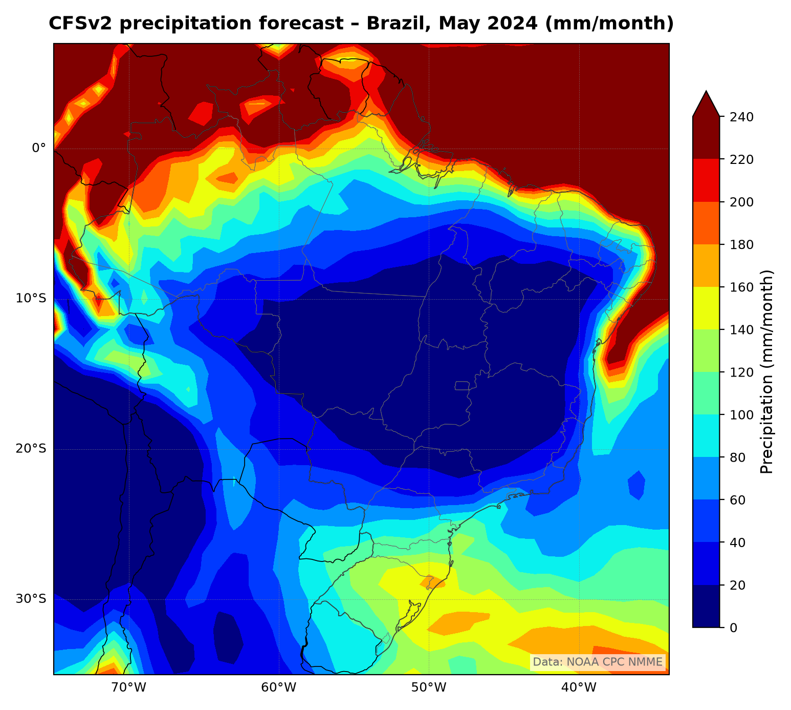
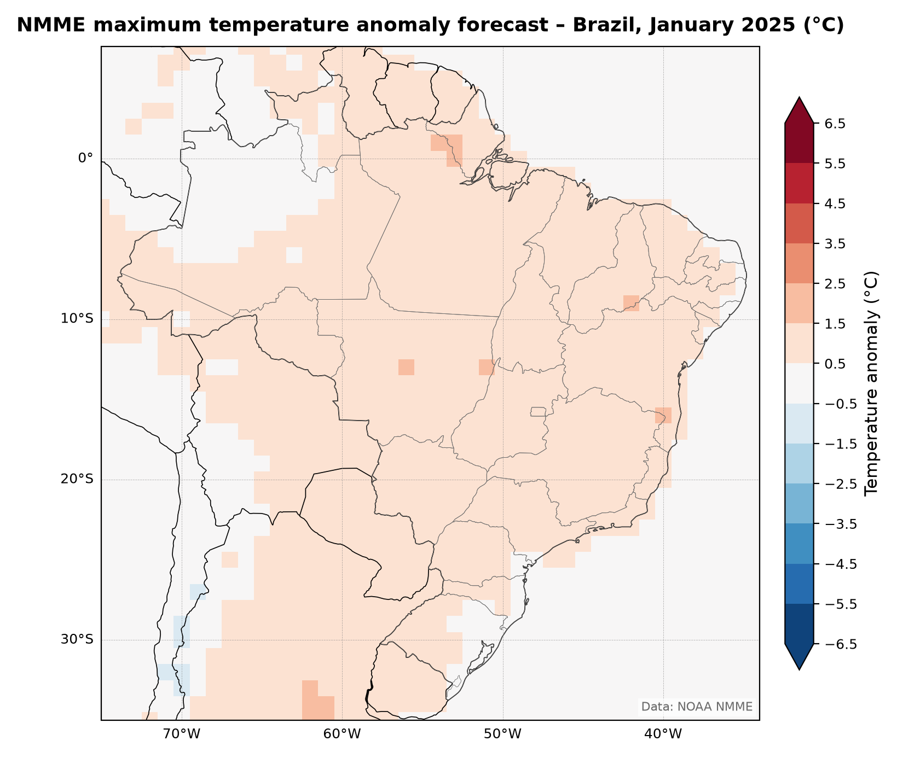
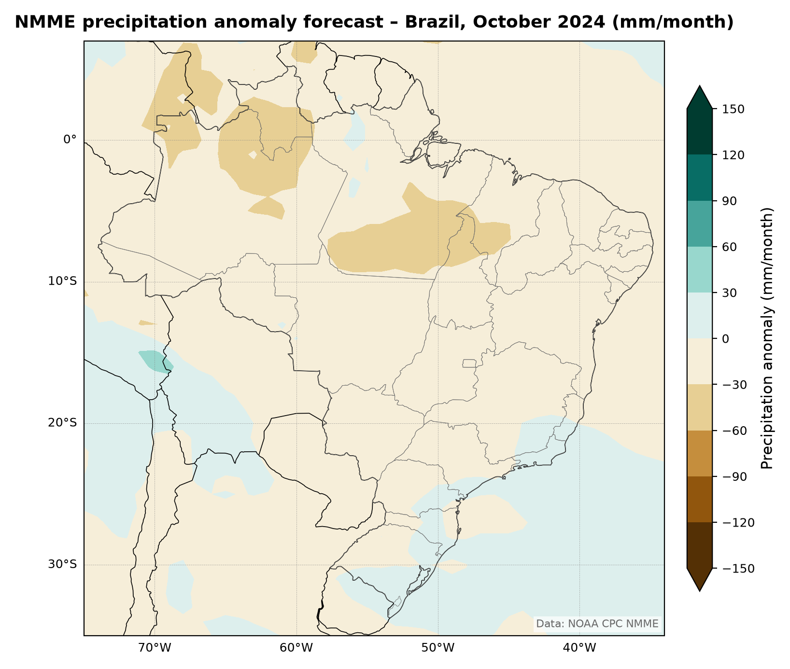

# NMME Seasonal Forecast Maps

**Seasonal forecast maps of Brazil from the North American Multi-Model Ensemble (NMME): monthly precipitation, precipitation anomaly and temperature anomaly, one map per target month.**

[](https://github.com/valkiriaandrade/nmme-seasonal-forecast-maps/actions/workflows/tests.yml)

[](LICENSE)

## Gallery

| | |
|:-:|:-:|
|  |  |
| NMME maximum temperature anomaly forecast, October 2024 (July 2024 run) | CFSv2 monthly precipitation forecast, May 2024 (April 2024 run) |
|  |  |
| NMME maximum temperature anomaly forecast, January 2025 | NMME ensemble precipitation anomaly forecast, October 2024 |

## What it does

- Reads one or more NMME NetCDF files (one per model), checks that the grids match and
  averages them with equal weights (missing values propagate).
- Draws **one map per forecast target month**:
  - `precipitation`: monthly total in mm/month, converted from the file's rate (mm/s, mm/day)
    using the real number of days in each month (leap years included);
  - `precipitation-anomaly`: the same conversion applied to anomaly files;
  - `temperature-anomaly`: anomaly in °C (a 1 K difference equals 1 °C).
- Titles name the model, quantity, region, target month and units; maps have coastline,
  country and state borders, lat/lon labels and a source credit.

## Data source

The [**North American Multi-Model Ensemble (NMME)**](https://www.cpc.ncep.noaa.gov/products/NMME/)
is a seasonal prediction system coordinated by NOAA. Each month several coupled climate
models (CFSv2, CanESM5, GEM5.2-NEMO, GFDL SPEAR, NASA GEOS5v2, NCAR CCSM4, NCAR CESM1, …) issue
forecasts up to 9–12 months ahead on a 1° global grid. Ensemble-mean forecasts and anomalies
are distributed by the [IRI Data Library](https://iridl.ldeo.columbia.edu/SOURCES/.Models/.NMME/)
and NOAA CPC.

All files used here come from the **NOAA CPC NMME real-time archive**,
https://ftp.cpc.ncep.noaa.gov/NMME/realtime_anom/ENSMEAN/ (public domain).

*Data: NOAA Climate Prediction Center – North American Multi-Model Ensemble.*

| File / folder in `data/` | Content | In the repo? |
|---|---|---|
| `CFSv2.prate.202404.ENSMEAN.fcst.nc` | CFSv2 precipitation rate (mm/s), April 2024 run, 9 target months | committed sample |
| `NMME.tmax.202407.ENSMEAN.anom.nc` | NMME maximum temperature anomaly (K), July 2024 run, 12 target months | committed sample |
| `nmme_202407_forecasts/*.prate.202407.ENSMEAN.fcst.nc` | Precipitation forecasts from 7 NMME models, July 2024 run | committed sample |
| `nmme_202407_anomalies/NMME.prate.202407.ENSMEAN.anom.nc` | NMME ensemble precipitation anomaly (mm/s), July 2024 run | `make data` |

## Get the data

```bash
make data                          # or: python scripts/download_data.py
```

This downloads from NOAA CPC exactly what the README examples and `make figures` need, and
skips files that are already there. Other runs, variables or models:

```bash
python scripts/download_data.py --run 202410 --variable prate tmax --kind anom --model NMME
python scripts/download_data.py --run 202410 --kind fcst --model CFSv2 GFDL_SPEAR
python scripts/download_data.py --dry-run          # only list the URLs
```

Custom downloads go to `data/nmme_<YYYYMM>_<anomalies|forecasts>/`. `--variable`, `--kind`
and `--model` need `--run`. Downloaded files are git-ignored, and a file missing on the server
is reported by name. A download cut off midway is retried, never saved under its final name.

## Install

Python 3.10 or later.

```bash
git clone https://github.com/valkiriaandrade/nmme-seasonal-forecast-maps.git
cd nmme-seasonal-forecast-maps
python -m venv .venv
source .venv/bin/activate          # Windows PowerShell: .venv\Scripts\Activate.ps1
python -m pip install -e ".[dev]"  # or: make install
```

## Quick start

```bash
make data                          # fetch the files that are not committed

# CFSv2 monthly precipitation for every target month of the April 2024 run
nmme-maps --product precipitation --input data/CFSv2.prate.202404.ENSMEAN.fcst.nc \
          --output output/cfsv2

# NMME maximum temperature anomaly, only October-December 2024
nmme-maps --product temperature-anomaly --input data/NMME.tmax.202407.ENSMEAN.anom.nc \
          --months 2024-10 2024-11 2024-12 --output output/tmax

# NMME precipitation anomaly, July 2024 run (needs `make data`)
nmme-maps --product precipitation-anomaly \
          --input data/nmme_202407_anomalies/NMME.prate.202407.ENSMEAN.anom.nc --output output/panom

# 7-model ensemble mean precipitation of the July 2024 run (a folder: every .nc inside)
nmme-maps --product precipitation --input data/nmme_202407_forecasts --output output/ensemble

# Rebuild every figure in figures/
make figures                       # or: python scripts/make_figures.py
```

Monthly totals use the actual number of days in each month (28–31), not a fixed 30 days.

The target months and the precipitation units are read from the file. In the NOAA CPC files
the `target` axis counts months since 1960-01, and the first target is the initialisation month
(the July 2024 run starts at July 2024). `--start` is only needed for files without such an axis;
if you give it anyway, it must match the file. Likewise `--units` must agree with the file's
`units` attribute. Anomaly products expect files that already contain anomalies; no
climatology is subtracted.

## CLI options

`nmme-maps --help` prints the full list.

| Option | Default | Description |
|---|---|---|
| `--input PATH [PATH ...]` | *required* | One or more NetCDF members, or folders of them (averaged with equal weights) |
| `--start YYYY-MM` | from the file | First target month; only needed if the file's target axis has no `months since` units, and checked against it otherwise |
| `--output DIR` | *required* | Output directory (one PNG per target month) |
| `--product` | `precipitation` | `precipitation`, `precipitation-anomaly` or `temperature-anomaly` |
| `--units` | from the file | Precipitation rate unit: `mm/s`, `mm/day` or `mm/month`; must agree with the file's `units` attribute |
| `--months YYYY-MM ...` | all | Only plot these target months (each must be in the file) |
| `--region {brazil,north,south}` | `brazil` | Map domain; the Portuguese aliases `brasil`, `norte` and `sul` are also accepted |
| `--filename TEMPLATE` | `{product}_{year}-{month:02d}.png` | Output file name template |
| `--variable NAME` | `fcst` | NetCDF variable |
| `--target-dim NAME` | `target` | Forecast-month dimension |
| `--shapefile FILE` | – | Optional state boundaries (`.shp` or zipped) to mask the field; by default Natural Earth borders are drawn |
| `--title TEXT` | built from the data | Custom map title; `{month}` is replaced by each target month |
| `--dpi N` | `200` | PNG resolution |
| `--verbose` | off | Debug logging and full tracebacks |

Shortcuts in `scripts/` preset `--product`: `cfsv2_precipitation.py`,
`precipitation_anomaly.py` and `nmme_max_temperature_anomaly.py`.

## Project structure

```
nmme-seasonal-forecast-maps/
├── data/                  # sample NMME / CFSv2 files; `make data` adds the rest
├── figures/               # published maps (rebuilt with `make figures`)
│   └── precipitation_anomaly/
├── scripts/
│   ├── download_data.py   # downloads NMME files from NOAA CPC (`make data`)
│   ├── make_figures.py    # regenerates every figure in figures/
│   └── *.py               # shortcuts for the CLI
├── src/nmme_maps/
│   ├── cli.py             # command-line interface
│   ├── processing.py      # target months, unit conversion, ensemble mean
│   ├── io.py              # NetCDF reading and grid checks
│   ├── plotting.py        # shared map style and rendering
│   ├── colour_scales.py   # palettes and class levels of each product
│   ├── labels.py          # titles, model names and unit labels
│   └── regions.py         # map domains and region aliases
├── tests/                 # pytest suite (synthetic data; network access is blocked)
├── docs/                  # validation notes and project history
├── Makefile
└── pyproject.toml
```

## Development

```bash
make install   # editable install with dev tools + pre-commit hooks (ruff)
make test      # pytest with coverage report (fails below 80%)
make lint      # ruff check + ruff format --check
make data      # download the NMME files from NOAA CPC (manual step, never run in CI)
make figures   # regenerate every figure in figures/ from data/
```

On Windows without `make`, run the commands from the [Makefile](Makefile) directly, e.g.
`python -m pytest -q --cov` or `python scripts/make_figures.py`. The first map run without a
shapefile downloads Natural Earth borders (cached afterwards).

Tests and CI never download anything: they use the committed samples and synthetic data, and
a test fixture blocks network access. `make data` is a manual step.

## License

Code: [MIT](LICENSE) © Valkiria Andrade. NMME data: NOAA Climate Prediction Center and the
participating modelling centres (public domain). Coastlines and borders on the maps come from
[Natural Earth](https://www.naturalearthdata.com/) (public domain).

---

Project history: [original README](docs/README-original.md).
