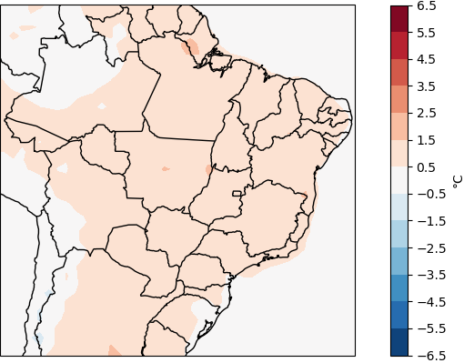

# NMME

Weather data processing and visualisation project by Valkiria Andrade.
The code is organised as a Python package with a command-line interface,
regression tests and automated checks on GitHub Actions.



## Installation

Python 3.10 or later. From this repository's folder:

```bash
python -m venv .venv
# Windows PowerShell: .venv/Scripts/Activate.ps1
# Linux/macOS: source .venv/bin/activate
python -m pip install -e ".[dev]"
```

WRF and MERGE also need ecCodes: `python -m pip install -e ".[grib]"`.
The ecCodes package ships binaries for Windows, Linux and macOS. NetCDF, calculations and
maps do not depend on this extra. GRIB files are read directly with ecCodes, replacing pygrib.

## Usage

Example (check your files' names and metadata):

```bash
nmme-maps --input Dados/CFSv2.prate.202404.ENSMEAN.fcst.nc --start 2024-04 --units mm/s --output output/cfsv2
nmme-maps --help
```

Set `--start` to the first target month after checking the file's coordinates. `--target-dim` lets you choose the forecast dimension. Unit conversion uses the Gregorian calendar (28/29/30/31 days), with the unit given explicitly; 360_day calendars must be converted beforehand. Anomaly products expect files that already contain anomalies; they do not subtract a climatology automatically. Members are equally weighted and incompatible grids are rejected.

`--shapefile path/BR_UF_2022.shp` applies a mask and local boundaries; the file
must come with its auxiliary files and CRS. ZIP files must be extracted first.
Without a shapefile, Cartopy may download Natural Earth cartography on first use.
`--title` sets the title and `--verbose` shows error details.
Maps are saved without opening windows. The output folder is created automatically.

## Architecture and maintenance

- `src/nmme_maps/io.py`: reading, resource cleanup and grid validation.
- `src/nmme_maps/cli.py`: arguments and processing coordination.
- `src/nmme_maps/plotting.py`: rendering and geographic masking.
- `Scripts/`: entry points with the historical names, using the installed package.
- `tests/`: synthetic data and regression tests independent of external services.
- `Dados/` and `Figuras/`: original data and figures, preserved.

The historical entry points now require the same arguments as the CLI. Paths,
dates and files that used to be hard-coded must be passed explicitly.
Palettes and resolution were standardised; figures are not pixel-perfect copies
of the old versions. Missing values are not converted to zero.

```bash
pytest -q
ruff check src Scripts tests
```

CI runs the tests on Python 3.10 and 3.12. Tests use small synthetic data
and local cartography; scientific interpretation and period coverage should be
checked against operational data.

History, scientific background and images: [original README](docs/README-original.md).
