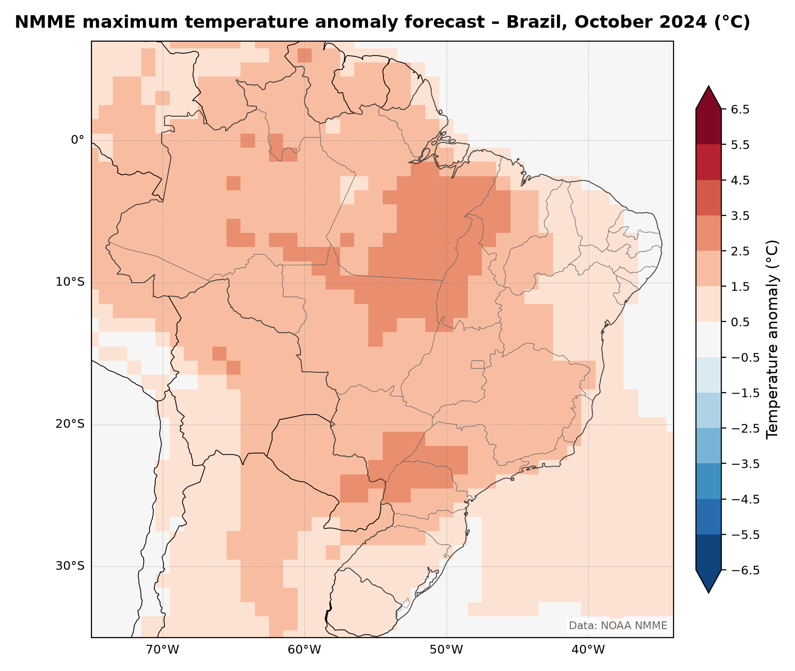

# NMME

> **Project history.** This is the original README, kept for reference. Folder and file
> names have been updated to the current English layout; see the main [README](../README.md).

This repository contains scripts and data for plotting raw precipitation and temperature data from NOAA's NMME product. NMME (North American Multi-Model Ensemble) is a project that provides climate forecasts using a combination of multiple climate models.

## Description

The goal of this project is to visualise the raw precipitation and temperature data provided by NOAA's NMME. We use several Python plotting libraries to create maps that help interpret the climate data.

## Repository structure

- `scripts/`: scripts used to process and analyse the data.
- `data/`: raw and processed data.
- `figures/`: figures generated from the data.

## Prerequisites

Before running the scripts, you will need to install the following Python libraries:

- numpy
- pandas
- matplotlib
- cartopy
- xarray
- netCDF4

## Images

### Figure 1: Example of a monthly precipitation anomaly forecast - ENSEMBLE


### Figure 2: Example of a monthly maximum temperature anomaly forecast - NMME



### Figure 3: Example of an accumulated precipitation forecast - CFSv2


## How to use

1. Clone this repository:
    ```bash
    git clone https://github.com/valkiriaandrade/nmme-seasonal-forecast-maps.git
    ```

2. Go to the project folder:
    ```bash
    cd nmme-seasonal-forecast-maps
    ```

3. Run the scripts as needed.

## Contributing

Contributions are welcome! Feel free to open issues and pull requests.

## License

This project is licensed under the MIT License. See the [LICENSE](../LICENSE) file for details.
